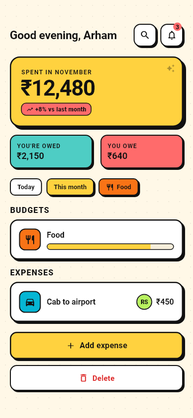
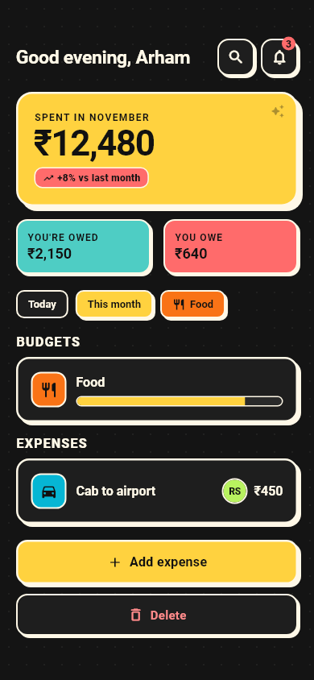

# SplitMate Design System — "Pop Brutal" (v2.1)

> Chosen with the **UI/UX Pro Max** skill. It searched its style, colour and typography data for a "fintech bill-splitting app, Gen-Z, playful", and its top matches were:
> - style `neubrutalism` (best for "Gen Z brands, startups")
> - type pairing "Neo Brutalism Mobile (Space Grotesk)"
>
> It replaces the v2.0 "Midnight Aurora" look, which used violet→cyan gradients.
>
> Code: `lib/core/theme/` (tokens + ThemeData) and `lib/shared_widgets/` (components).
> **Rule #1:** screens never hard-code a colour, radius, font size or duration. Always use tokens, the theme, or components.

| Light | Dark |
|---|---|
|  |  |

*(Previews were rendered from the real components. The typeface in the previews is a stand-in, because Space Grotesk isn't cached on the build machine.)*

## 1. Personality

Paper, ink and stickers: cream paper, thick ink outlines, hard **unblurred** offset shadows, and loud pop colours. It feels friendly, confident and a little cheeky, never corporate. Tapping a surface makes it **slide into its shadow**, like pressing a real button.

### Fit for a money app (rules that keep it from looking odd)

Playful in the frame, serious about the numbers:
- **Amounts are always plain and readable.** Large tabular figures in ink, with no decoration on or near them, and the same ₹ format everywhere.
- **Colour carries meaning, not mood:**
  - mint / green = money coming to you;
  - coral / red = money you owe;
  - yellow = the one main action on a screen.
  - Every money colour is always paired with words ("You owe", "owes you"), never colour alone.
- **One loud element per screen** (the hero card or the main button). Lists, rows and forms stay on calm white paper.
- **Fun is for empty and happy moments only:** tilted stickers, confetti and the wobbling logo appear in empty states, celebrations and onboarding.
- **Destructive or financial confirmations stay straight and quiet:** delete, leave, record payment and pay via UPI.
- No jokes or slang in money copy. State facts plainly ("You owe Riya ₹250").

## 2. Structure tokens (`Brutal`, `Radii`)

| Token | Value | Use |
|---|---|---|
| `Brutal.border` | 2.5 px | Cards, hero cards, sheets |
| `Brutal.borderThin` | 2 px | Buttons, chips, inputs, small tiles |
| `Brutal.shadow` | 4 px offset, 0 blur | Cards and primary buttons (hero cards use 6) |
| `Brutal.shadowSmall` | 3 px | Secondary buttons, chips, icon buttons |
| Radii | 10 chip · 14 tile/button · 16 card · 20 hero · 22 sheet | Slightly rounded, never pill-soft |

## 3. Colour (`context.aurora`)

| Token | Light | Dark | Use |
|---|---|---|---|
| `bg` | cream `#FFF8E7` + dot grid | `#141414` + dot grid | Scaffold |
| `surface` | `#FFFFFF` | `#1E1E1E` | Cards, inputs |
| `surfaceHigh` | `#F6EEDB` | `#2A2A2A` | Tracks, neutral pills |
| `ink` | `#111111` | cream `#FFF8E7` | **Outlines and hard shadows** |
| `cta` | yellow `#FFD23F` | yellow `#FFD23F` | Primary buttons, hero card, selected chips and tabs |
| `onPop` | `#111111` | `#111111` | Text and icons on any pop fill (always ink) |
| `text` / `textMuted` | `#111111` / `#57534A` | `#FFF8E7` / `#BDB7A8` | Body text (≥ 7:1) |
| `primary` | `#6D28D9` | `#A78BFA` | Links, focus |
| `positive` / `negative` | `#15803D` / `#DC2626` | `#4ADE80` / `#FF8A8A` | Money **text**: owed to you / you owe |
| `positiveFill` / `negativeFill` | mint `#4ECDC4` / coral `#FF6B6B` | same | Money **tiles** (ink text) |

**Pop palette** (`Palette.pops`), used for avatars, group tiles, story cards and confetti:
- yellow `#FFD23F`
- mint `#4ECDC4`
- coral `#FF6B6B`
- violet `#A78BFA`
- sky `#74B9FF`
- pink `#FF8FAB`
- lime `#B8F25F`
- orange `#FF9F43`

Each person or group gets a stable colour via `Palette.popFor(id)`.

**Contrast is verified by `test/theme_contrast_test.dart`:**
- text ≥ 4.5:1 on all surfaces in both themes;
- ink on every pop colour ≥ 4.5:1;
- outlines ≥ 3:1.

## 4. Typography

**Space Grotesk** everywhere (`AppTheme._font`), with tabular figures for amounts (`AppTheme.tabular`).

| Style | Size / weight |
|---|---|
| `displayLarge` | 44 / 700, tight tracking (hero amounts) |
| `headlineLarge` | 30 / 700 (screen titles) |
| `titleLarge` / `titleMedium` | 21 / 18, 700 |
| `bodyLarge` / `bodyMedium` | 16 / 14, 500 |
| `labelSmall` | 12 / 700, +1.1 tracking, used **UPPERCASE** for overlines ("SPENT IN NOVEMBER") and section headers |

## 5. Motion

| Pattern | Where |
|---|---|
| Press-in: surface slides 3–4 px into its shadow, 120 ms, with a haptic | Every `BrutalSurface` (cards, buttons, tiles) |
| Pop-in entrance: fade + slide with a slight `easeOutBack` overshoot, 50 ms stagger | Lists and sections |
| Count-up amounts | Hero numbers, balances |
| Tilted sticker wobble | Brand mark, empty-state badges, confirm-sheet icons |
| Confetti in the pop palette | A debt reaches ₹0 |

All motion is skipped under the system "reduce motion" setting. Press-in uses `transform` only, so the layout never shifts (UI/UX Pro Max rule "Stable Interaction States").

## 6. Components (`lib/shared_widgets/`)

| Component | Notes |
|---|---|
| `BrutalSurface` | **Core primitive**: fill, ink border, hard shadow, press-in, semantics |
| `AppCard` | Paper card (wraps `BrutalSurface`) |
| `GradientCard` | Pop-colour hero card, yellow by default; the name is kept from v2.0 |
| `PopTile` | Small pop-colour stat tile (owed / owe) |
| `AuroraBackground` | Paper with a faint dot grid |
| `PrimaryButton` / `SecondaryButton` / `TonalIconButton` | Chunky outlined buttons that press in |
| `Pill` | Sticker label with a pop fill and ink text |
| `CategoryBubble` / `IconBadge` | Solid colour tiles with ink outlines |
| `ChoiceChipX` | Paper when off; pop fill and hard shadow when on |
| `SoftProgressBar`, `ProgressRing` | Outlined track, solid fill |
| `PersonAvatar` / `AvatarStack` | Pop-colour initials with ink rings |
| `EmptyState`, `ErrorState`, `Skeleton*` | Tilted yellow badge, friendly copy, shimmer |
| `CodeChip`, `Toast`, `confirmAction`, `Celebrate` | As in v2.0, restyled |

Charts: donut slices and bars have 2 px ink outlines. The current or selected bar is yellow and the rest are violet.

## 7. Do / Don't

- ✅ Use `c.onPop` for anything on a pop fill. ❌ White text on yellow or mint.
- ✅ Use `c.amountColor(v)` for money text and `c.amountFill(v)` for money tiles.
- ✅ Use `BrutalSurface` for anything tappable that looks like a card or button. ❌ Hand-rolled `BoxShadow` with blur.
- ✅ Use vector icons in sticker tiles. ❌ Emoji as icons (emoji are fine inside sentences, like toasts or the greeting).
- ✅ Use `Money.format(x)` and tabular figures.
