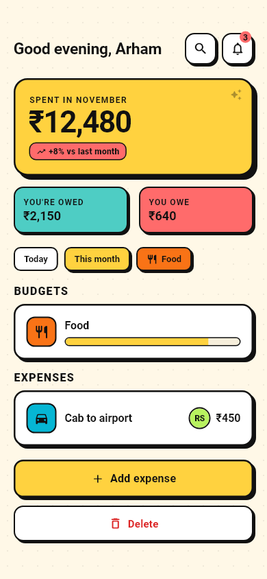
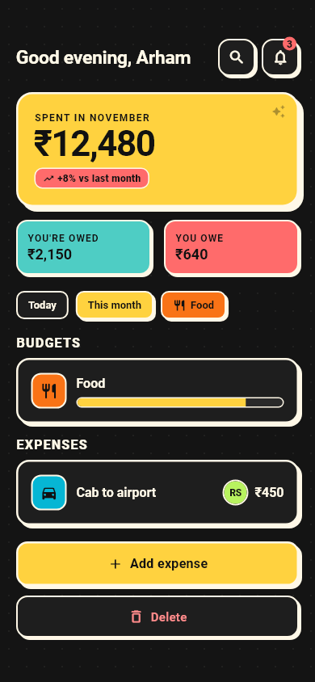

<p align="center">
  
</p>

<h1 align="center">SplitMate</h1>

<p align="center">
  Track what you spend, split bills with friends, and settle up without the awkward follow-up messages.
</p>

## Download

**[Download SplitMate v2.5.0 for Android (APK)](https://github.com/AK-3112511/split_mate/releases/download/v2.5.0/app-release.apk)**

1. Open the link on your Android phone and download the APK.
2. When Android asks, allow your browser or file manager to install apps from this source.
3. Open SplitMate and create an account, or continue with Google.

If you have a 1.x version installed, please update. Older builds can no longer sync with the server.

## About

SplitMate is an expense tracker and bill-splitting app for flatmates, trips and office lunches. It keeps two things in one place:

- **Your own spending:** categories, budgets, trends and a monthly recap.
- **Shared spending:** groups, splits, balances and settling up.

The two are connected. When you pay for a group dinner or settle your share of one, that amount shows up in your personal ledger too, so your monthly total reflects what you actually spent.

## Features

### Personal expenses
- Add, edit and delete expenses, with Undo after deleting.
- Every expense can have a category, notes and a receipt photo, and can be back-dated.
- Recurring expenses (weekly or monthly) for rent, subscriptions and other regular bills.
- Monthly budgets per category, with a warning at 80% and another when you go over.
- Home dashboard: this month's total, the change from last month, a category breakdown and six months of trends. View today, this week, this month, all time or a custom range.
- Search across personal and group expenses.
- A monthly recap you can share as an image.
- Export to CSV or PDF for any date range.

### Groups and splitting
- Create a group and invite friends. Others can join with a 6-character code or an invite link.
- Four ways to split: equally, by exact amounts, by percentage, or item by item. A running "left to assign" counter shows what's still unassigned before you save.
- All amounts are calculated in whole paise, so shares always add up to the total.
- Balances show exactly who owes whom. An optional "simplify" view reduces the number of payments needed.
- An activity log records every expense added, edited or deleted, and members are notified.
- Admins can rename the group, manage members and generate a new invite code. The last admin can't leave a group without handing over first.
- Export a PDF report of the whole group.

### Settling up
- Record full or partial payments, from either side: the person who paid or the person who was paid back.
- **Pay via UPI** opens your UPI app (Google Pay, PhonePe, Paytm and others) with the payee and amount already filled in. SplitMate never handles money itself; it only records the payment once you confirm it went through.
- Send a reminder to someone who owes you (at most once a day per person in each group).

### Friends and notifications
- Add friends with a short friend code. Look-alike characters such as 0/O and 1/I are left out, so codes are easy to read out loud.
- Each friend shows your overall balance with them across every group you share.
- Nicknames that only you can see.
- One notifications inbox. Tapping a notification takes you to the right screen.

### Everyday details
- Light, dark and system themes.
- Works offline: expenses you add without a connection are saved and synced once you're back online.
- Respects the system "reduce motion" setting.

## Screenshots

| Light | Dark |
|:---:|:---:|
|  |  |

## Built with

| Area | Tools |
|---|---|
| App | Flutter (Dart), Riverpod for state, go_router for navigation |
| Backend | Firebase Authentication (email and Google), Cloud Firestore |
| UI | Custom design system, Space Grotesk, fl_chart, flutter_animate |
| Integrations | UPI deep links (`url_launcher`), invite links (`app_links`), PDF and CSV export, sharing |

The app runs on Firebase's free Spark plan, so there are no Cloud Functions. All the money logic (splits, balances, settlement and recurring schedules) runs on the device in plain Dart and is covered by unit tests. Firestore security rules decide who can read and change each group, expense and friendship.

### Project structure

```text
lib/
├── core/             Split, settlement and recurrence logic; router; theme; utilities
├── features/         One folder per feature: auth, home, personal_expenses, groups,
│                     friends, notifications, categories, profile, recap, search, export
├── shared_widgets/   Reusable cards, buttons, inputs, avatars and states
└── main.dart
test/                 Unit and widget tests
firestore.rules       Firestore security rules
```

## Running it locally

**Requirements:** Flutter 3.50 or newer, an Android device or emulator, and a Firebase project if you want to use your own backend.

1. Clone the repository and install dependencies.

   ```bash
   git clone https://github.com/AK-3112511/split_mate.git
   ```

   ```bash
   cd split_mate
   ```

   ```bash
   flutter pub get
   ```

2. Connect your own Firebase project. This step is optional: without it, the app uses the existing SplitMate Firebase project.
   - In the Firebase console, create a project and turn on **Email/Password** and **Google** sign-in under Authentication.
   - Create a Cloud Firestore database.
   - Run the FlutterFire CLI. It regenerates `lib/firebase_options.dart` and `android/app/google-services.json`.

   ```bash
   flutterfire configure
   ```

   - For Google sign-in, add your signing key's SHA-1 fingerprint to the Android app in the Firebase console.

3. Deploy the security rules.

   ```bash
   firebase deploy --only firestore:rules
   ```

4. Run the app.

   ```bash
   flutter run
   ```

### Tests

```bash
flutter test
```

```bash
flutter analyze
```


